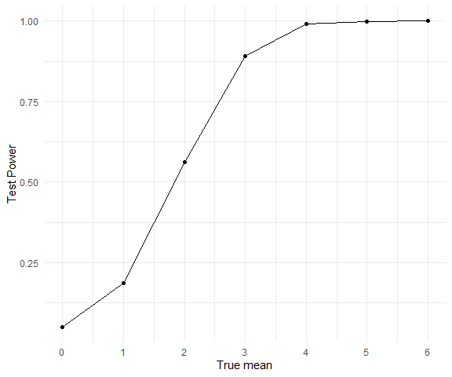
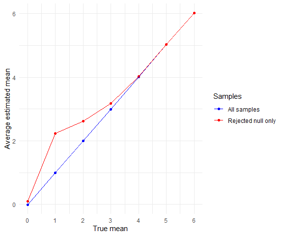

Homework 5
================
Ian O’Keeffe
2026-11-17

## Problem 1

``` r
birthday_results_df = expand_grid(
  number_of_people = 2:50,
  iter = 1:10000
) |> 
  mutate(
    repeated_birthdays = map_lgl(number_of_people, create_birthdays)
  )

group_df = birthday_results_df |>
  group_by(number_of_people) |> 
  summarize(repeat_probability = mean(repeated_birthdays))

group_df |> 
  ggplot(aes(x = number_of_people, y = repeat_probability)) +
  geom_hline(yintercept = 0.5, linetype = "dashed", color = "red") +
  annotate(
    "label", 
    x = 25, y = 0.45, 
    label = "23 people = ~50.7% chance", 
    hjust = 0, size = 3.5, fill = "white"
  ) +
  geom_point(color = 'blue') +
  geom_line() +
  labs(
    x = "Number of People in the Room",
    y = "Probability of a Shared Birthday")
```

<!-- -->

Once there are at least 23 people in the room, there is a greater than
50% chance that two people share a birthday. With 50 people in the room,
there is a 96.93% chance of two people sharing a birthday.

## Problem 2

``` r
file_names = list.files("./data", full.names = TRUE)

study_df = tibble(data = purrr::map(file_names, load_clean_csv)) |> 
  tidyr::unnest(cols = data)

exp_ids = sort(unique(study_df$id[startsWith(study_df$id, "exp")]))
con_ids = sort(unique(study_df$id[startsWith(study_df$id, "con")]))

subject_colors = c(
  setNames(colorRampPalette(c("lightblue", "darkblue"))(length(exp_ids)), exp_ids),
  setNames(colorRampPalette(c("salmon", "darkred"))(length(con_ids)), con_ids)
)
study_df |> 
  ggplot(aes(x = week, y = observation, group = id, color = id)) +
  geom_line() +
  scale_color_manual(values = subject_colors) +
  labs(
    x = "Week",
    y = "Observation")
```

<!-- -->

The control group has generally lower observation numbers than the
experiment group. There doesn’t seem to be much pattern to the control
group, but the observation values for the experiment group are higher at
the end of the 8 weeks.

## Problem 3

``` r
simulation_results = expand_grid(
  mu = 0:6,
  iteration = 1:5000
) |>
  mutate(results = map(mu, simulate_test)) |>
  unnest(cols = results) |>
  mutate(rejected = p_value < 0.05)
```

``` r
simulation_summary = simulation_results |>
  group_by(mu) |>
  summarize(
    power = mean(rejected),
    average_estimate = mean(mu_hat),
    average_estimate_rejected = mean(mu_hat[rejected]),
    .groups = "drop"
  )

simulation_summary
```

    ## # A tibble: 7 × 4
    ##      mu power average_estimate average_estimate_rejected
    ##   <int> <dbl>            <dbl>                     <dbl>
    ## 1     0 0.051         -0.00169                     0.101
    ## 2     1 0.187          1.00                        2.24 
    ## 3     2 0.561          2.00                        2.62 
    ## 4     3 0.890          2.99                        3.17 
    ## 5     4 0.990          4.01                        4.03 
    ## 6     5 0.999          5.03                        5.03 
    ## 7     6 1              6.01                        6.01

``` r
simulation_summary |> 
  ggplot(aes(x = mu, y = power)) +
  geom_point() +
  scale_x_continuous(breaks = 0:6) +
  geom_line() + 
  labs(
    x = "True mean",
    y = "Test Power"
  )
```

<!-- -->

As true mean increases from 0, test power increases.

``` r
simulation_summary |>
  pivot_longer(
    cols = c(average_estimate, average_estimate_rejected),
    names_to = "samples",
    values_to = "average_mu_hat"
  ) |>
  ggplot(aes(x = mu, y = average_mu_hat, color = samples)) +
  geom_point() +
  geom_line() +
  scale_x_continuous(breaks = 0:6) +
  scale_color_manual(
    values = c(
      average_estimate = "blue",
      average_estimate_rejected = "red"
    ),
    labels = c(
      average_estimate = "All samples",
      average_estimate_rejected = "Rejected null only"
    )
  ) +
  labs(
    x = "True mean",
    y = "Average estimated mean",
    color = "Samples"
  ) +
  theme_minimal()
```

<!-- -->

For all samples, the true mean and estimated mean match very closely.
For samples where the null hypothesis was rejected, we can see a much
higher mu hat when mu = 1, reflecting a selection bias. At mu = 0, the
positive and negative extremes are both selected, bringing mu hat closer
to mu.
