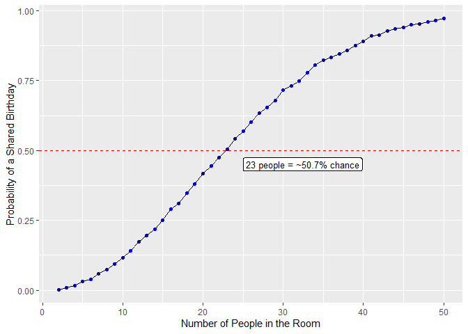

Homework 5
================
Ian O’Keeffe
2026-11-17

``` r
create_birthdays = function(n) {
  birthdays = sample(1:365, size = n, replace = T)
  repeated_birthdays = length(unique(birthdays)) < n
  
  return(repeated_birthdays)
}

birthday_results_df = expand_grid(
  number_of_people = 2:50,
  iter = 1:10000
) |> 
  mutate(
    repeated_birthdays = map_lgl(number_of_people, create_birthdays)
  )

group_df = birthday_results_df |>
  group_by(number_of_people) |> 
  summarize(repeat_probability = mean(repeated_birthdays))

group_df |> 
  ggplot(aes(x = number_of_people, y = repeat_probability)) +
  geom_hline(yintercept = 0.5, linetype = "dashed", color = "red") +
  annotate(
    "label", 
    x = 25, y = 0.45, 
    label = "23 people = ~50.7% chance", 
    hjust = 0, size = 3.5, fill = "white"
  ) +
  geom_point(color = 'blue') +
  geom_line() +
  labs(
    x = "Number of People in the Room",
    y = "Probability of a Shared Birthday")
```

<!-- --> Once there are
at least 23 people in the room, there is a greater than 50% chance that
two people share a birthday. With 50 people in the room, there is a
97.18% chance of two people sharing a birthday.
